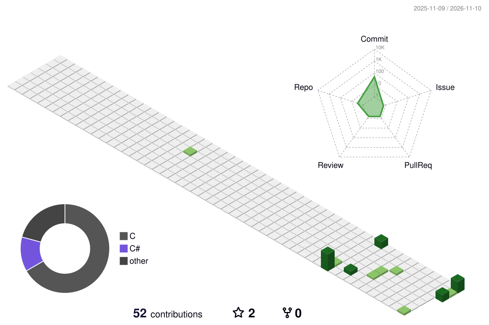

<!-- ═══════════════════════════════════════════════════════
  wei-ei-ei 的 GitHub 主页 README（BEPb 风格增强版）

  ⚠️ 贪吃蛇 + 3D 贡献图需要先配置 Actions：
  1. 把 snake.yml 和 profile-3d.yml 传到本仓库的 .github/workflows/ 目录
  2. 到仓库 Actions 页面分别手动 Run 一次（Run workflow 按钮）
  3. 等绿勾出现后刷新主页，图片就会显示
  贪吃蛇图存放在 output 分支，3D 图存放在仓库 profile-3d-contrib/ 目录
═══════════════════════════════════════════════════════ -->

<div align="center">

<!-- 顶部渐变横幅 -->


<!-- 打字动画 -->


<!-- 访客计数器 -->


</div>

## 🧐 关于我

- 🔭 正在折腾：写让芯片乖乖听话的代码，并尽量不让它 HardFault 罢工
- 🌱 正在修炼：视觉算法（OpenCV）和机械三维建模，目标是「机电软」三修满级
- 👯 想一起搞：一切会动、会看、会思考的小玩意儿
- 💬 可以问我：C/C++、STM32、串口为什么又乱码了
- ⚡ 冷知识：单片机的复位键，比咖啡更能解决我的问题

## 🧰 我的武器库

<!-- 留下你用的，删掉你不用的小徽章 -->
<div align="center">


</div>

## 📈 GitHub 活动图：贪吃蛇

<!-- 需要先运行 snake.yml 工作流一次，否则图片会裂开 -->
<div align="center">


</div>

## 📊 战绩统计

<!-- 换配色：把 tokyonight 改成 radical / dark / gruvbox 等 -->
<div align="center">


</div>

<div align="center">


</div>

## 🧾 档案速览

<!-- 不需要任何配置，直接可用 -->
<div align="center">


</div>

<div align="center">


</div>

<div align="center">


</div>

## 🧊 3D 贡献立体图

<!-- 需要先运行 profile-3d.yml 工作流一次，否则图片会裂开 -->
<div align="center">



</div>

## 🏆 成就奖杯

<div align="center">


</div>

## 📮 找到我

<!-- 把占位链接换成你自己的邮箱 / B站主页；不想要的整行删除 -->
<div align="center">

[](mailto:your@email.com)
[](https://space.bilibili.com/你的UID)

</div>

## ⚡ 每日循环

```c
while (alive) {
    eat();
    sleep();
    code();
    debug();   /* 没有解决不了的 bug，只有还没喂够的看门狗 */
}
```

<div align="center">


</div>
