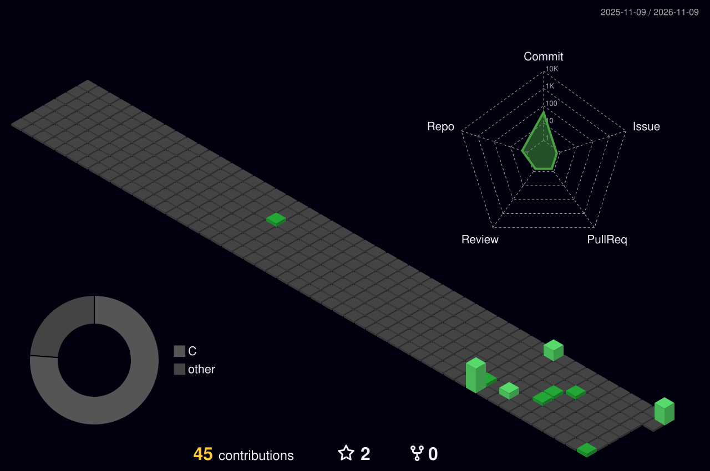
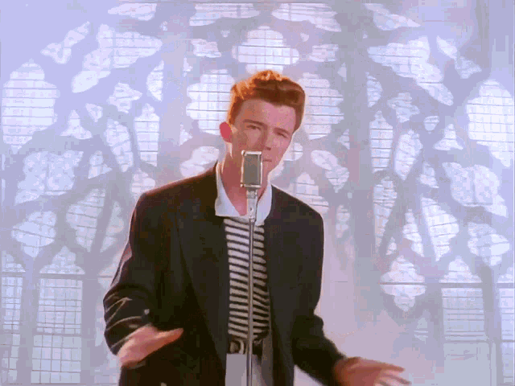

<!-- ============================================================
  wei-ei-ei's GitHub profile README — v3
  Palette: radical (pink #FE4287 / purple #C77DFF / cyan #A9FEF2)
  Stats widgets limited to region-friendly services.
============================================================ -->

<div align="center">

<!-- thin gradient wave -->


<!-- pixel-font welcome -->


<!-- tagline in terminal font -->


<!-- visitor counter -->


</div>

## 🧐 About Me

- 🕸️ Professional forum lurker, fun-project collector
- 🧪 Ships questionable experiments anyway
- 🤖 Talks to AI more than to humans. We vibe.
- 🌙 Founding member of the 3 AM Debugging Club
- 🚀 Motto: infinite progress

## 🧰 My Arsenal

<div align="center">


</div>

## 🍿 Meme Break

<div align="center">


</div>

## 🐍 The Snake Is Hungry

<!-- Generated daily by GitHub Actions -->
<div align="center">


</div>

## 📊 GitHub Stats

<!-- region-friendly widget set -->
<div align="center">


</div>

<div align="center">


</div>

<div align="center">


</div>

## 🧊 3D Contribution

<div align="center">



</div>

## 🏆 Achievements

<div align="center">


</div>

<div align="center">

<a href="https://forthebadge.com"></a>
<a href="https://forthebadge.com"></a>
<a href="https://forthebadge.com"></a>

</div>

## 📮 Find Me

<div align="center">

[](mailto:morgagreene866@gmail.com)
[](mailto:rxw789789@outlook.com)

</div>

## ⚡ Daily Loop

```c
while (alive) {
    eat();
    sleep();
    vibe_code();   /* AI does 80% of the work, I do the other 80% */
    debug();       /* it works on my machine, so it ships */
}
```

## 🎁 Free Reward, No Clickbait

<div align="center">



*never gonna give you up, never gonna let you down* 🎶

</div>

<div align="center">


</div>
